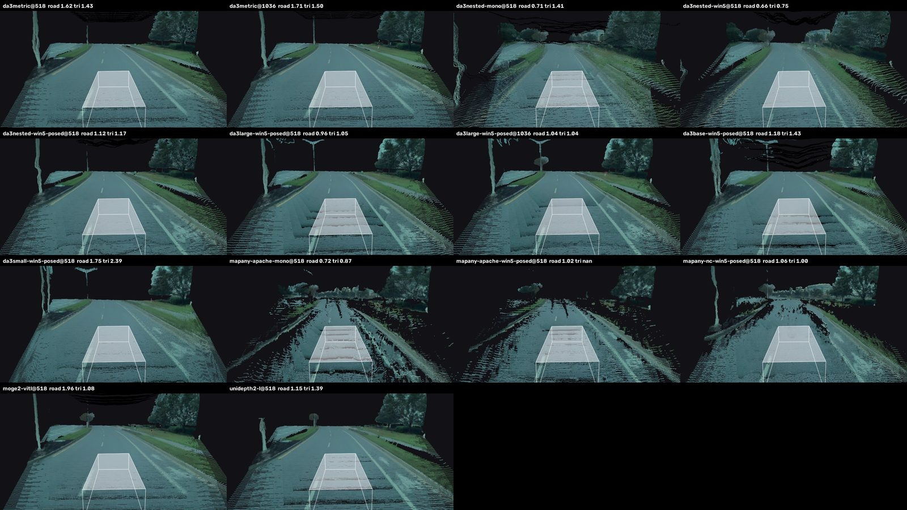
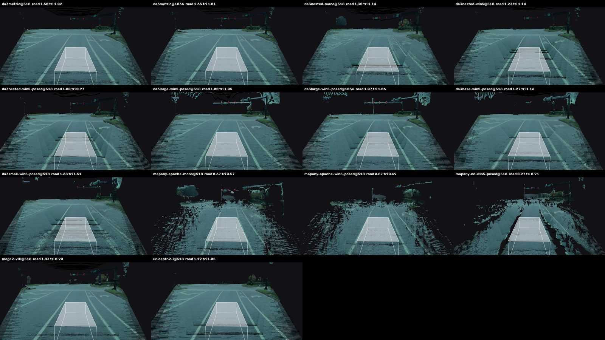
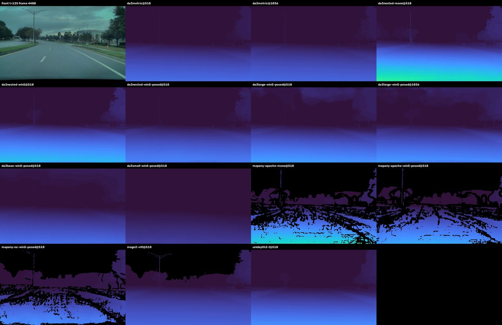
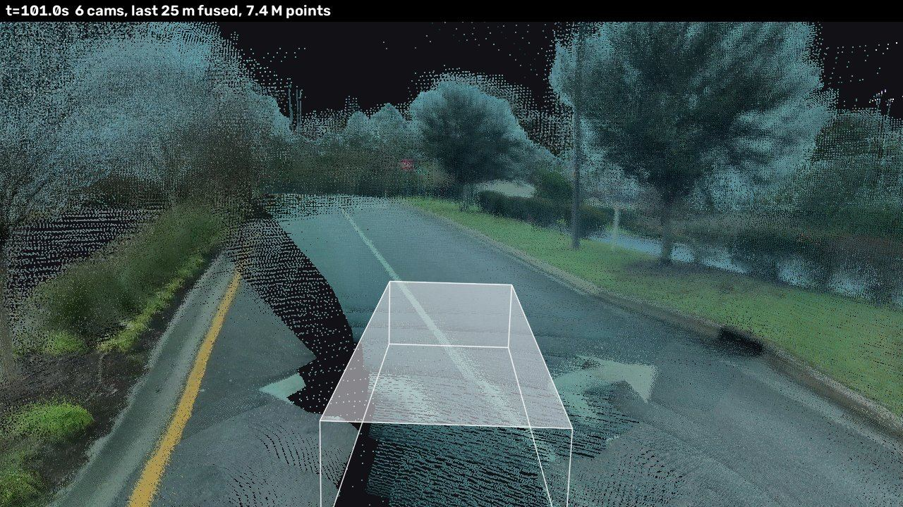
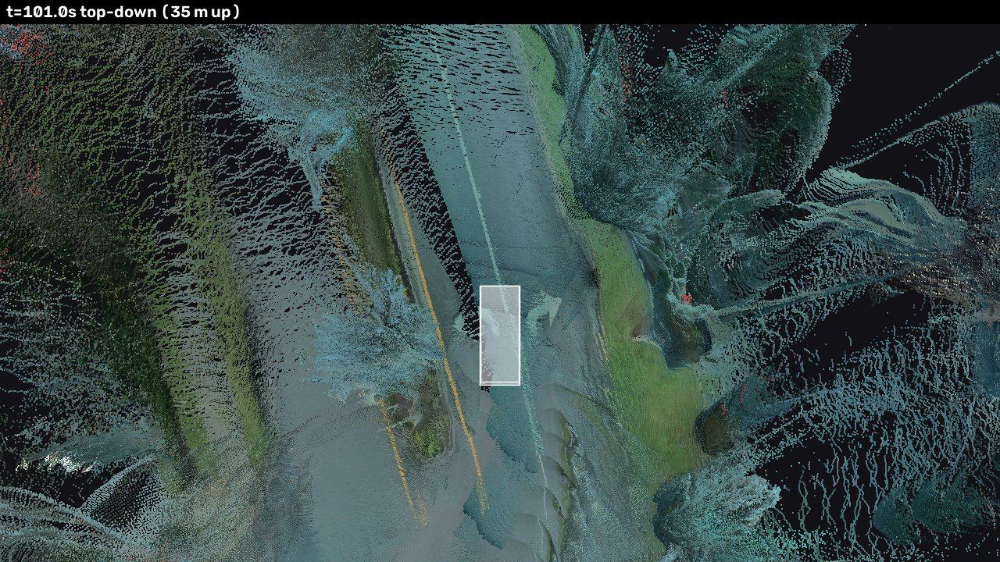
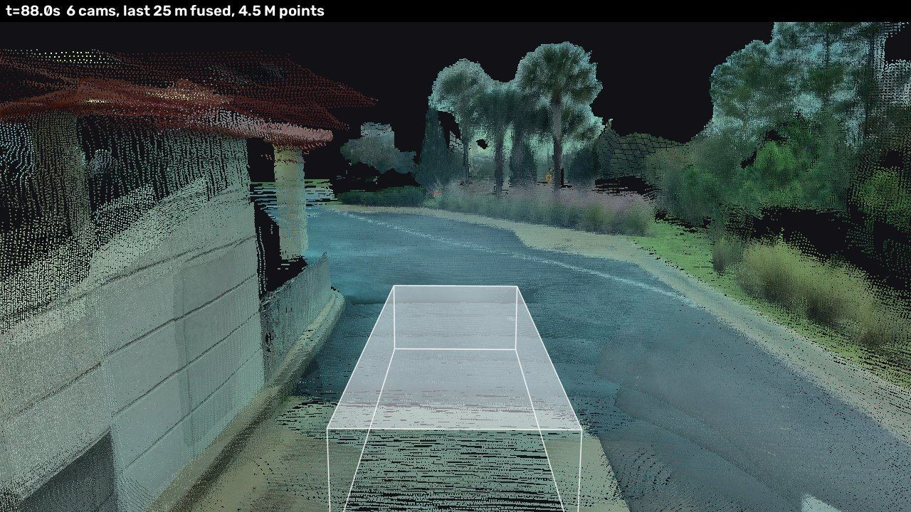
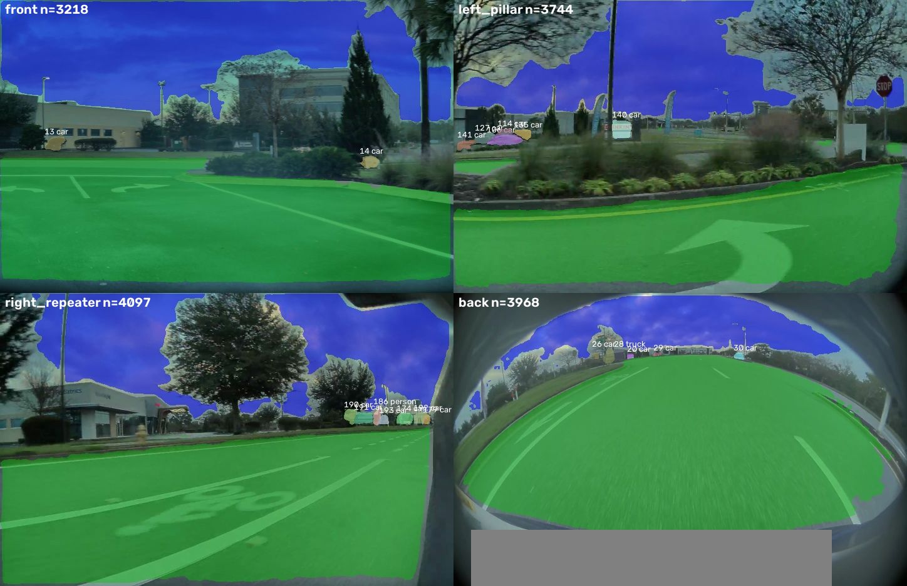
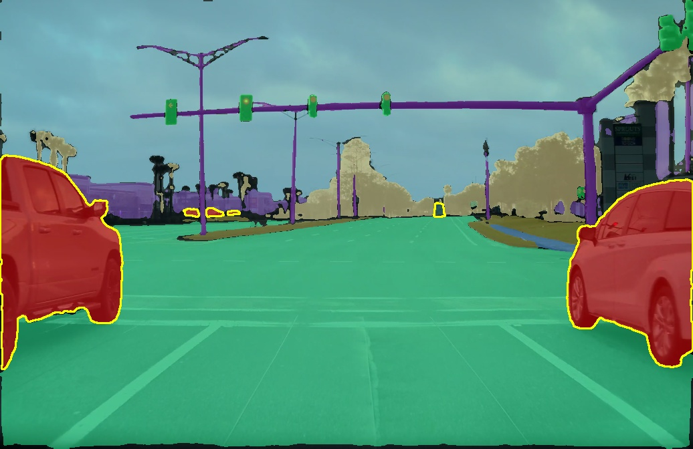
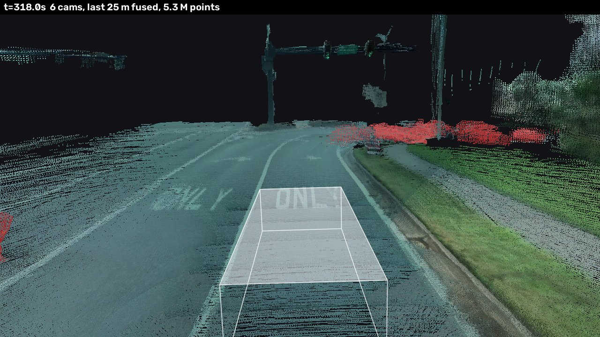
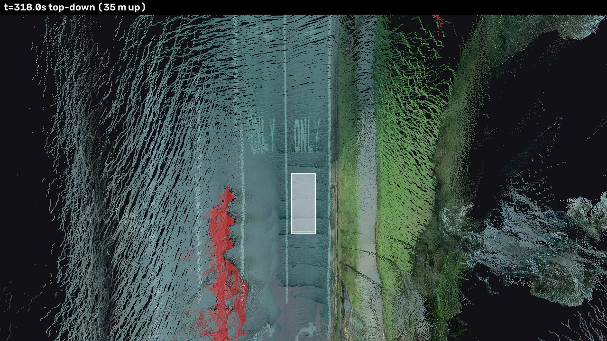

# Depth and masks: model bake-off and production tools

Stage 4 of Reality Splat. Question: which depth model gives the best metric, multi-view-consistent depth on this
Tesla HW4 drive on the M5 Ultra, and what produces sky and moving-object masks. Everything below was measured on
anomastudio (M5 Ultra, 64-core GPU, PyTorch 2.15 MPS) on real frames of this drive, with `calib/rig.json` and the
refined trajectory `poses/ego.npz` (both as of 16:10, 2026-11-21).

## Verdict

| Use | Model and settings | Why |
|---|---|---|
| **Live map, front + rear** | **DA3-LARGE-1.1**, pose-conditioned on rig x trajectory poses, causal window of 5 keyframes >= 1 m apart, 518x336 input; the rear fisheye as 3 level virtual views in one joint call (3 views x 3 frames) | Front: scale 1.04-1.05, shape error 3.9 %, temporal AbsRel 1.8 % (1 m) / 3.7 % (4 m). 0.041 s per image in a 6-image call (~0.21 s per keyframe incl. its context frames) |
| **Live map, pillars + repeaters** | **MapAnything (facebook/map-anything)**, intrinsics + poses + metric flag, same causal window, 518x336, its own validity mask off (full coverage) | Repeater: shape error 5.5 % vs 14.8 % for DA3-LARGE, temporal 3.4 / 6.0 % vs 4.3 / 8.8 %, scale 0.96-1.08 vs 0.84-0.97. Pillar: about a tie, slightly better scale. 0.115 s per image |
| **Offline map** | Same split at 1036x672 for DA3-LARGE-1.1 (front temporal AbsRel 1.3 / 2.1 %, shape 3.4 %; 0.165 s per image); MapAnything stays at 518 (1036 costs 4x and was not evaluated) | Quality over speed; a centred (non-causal) window is the obvious next step and was not tested |
| **Masks** | **Mask2Former Swin-L, Cityscapes panoptic**, on the original images at 724x469; IoU tracking; moving/parked from depth + ego motion | Sharp car/person/sky boundaries, 0.10 s per image |

- **Scale needs poses.** Every monocular "metric" model is off by 15-70 % on this footage, or unstable (DA3NESTED
  single-view: median 0.99 but IQR 0.39), and the error changes with the scene: DA3METRIC-LARGE puts the road plane 1.48x too far on the front camera, MoGe-2 1.69x, UniDepth v2 1.16x,
  MapAnything without poses 0.73x. Conditioning on the known ego motion fixes most of it: posed DA3-LARGE-1.1 is within
  4-7 % on the front and pillar (inter-moment IQR 0.05-0.07), posed MapAnything within 1-8 % on every camera; the
  repeater (looking back along the body, 0.73 m up) is the hardest lens for DA3 (triangulation scale 0.84).
- **No global correction is applied.** The residual bias of the posed models changes sign between cameras and
  references (front +4 %, pillar -3 to -5 %, repeater -4 to +8 %), so a fixed factor would be curve-fitting.
  Per-frame road-plane height ratios are written to `depth/<cam>/index.json` for the live fuser's scale check.
- **Simple corrections do not rescue monocular models.** Per-frame road-plane scale helps only the weaker posed
  models (DA3-BASE temporal 7.4 -> 3.6 %) and makes posed DA3-LARGE no better (3.7 -> 3.4 % front, 4.5 -> 5.0 %
  pillar). Chaining each frame's scale to the previous fused frame ("align to already-fused geometry") holds scale for
  posed models (front 1.04 -> 1.04) but drifts for monocular ones within 11 m (DA3METRIC 1.17 -> 0.70, MoGe-2
  1.05 -> 0.42).
- **Licences.** Both production depth models are CC BY-NC 4.0 (fine for this personal project). Commercial-safe
  alternative: MapAnything-apache on every camera (scale 0.97-1.04 on side cameras, but front temporal 7.7 % at 4 m)
  or DA3-BASE (Apache, about 2x worse than DA3-LARGE on the front).

## Speed on the M5 Ultra (MPS)

Median of 3-5 timed calls after a warm-up. "6 images" = all six cameras at one moment rectified to the same size
(posed models get the rig poses). Peak = largest MPS driver allocation during the calls (weights + activations +
allocator cache). Source: `work/depth/report/speed.json` (`bench_speed.py`).

| Model | Licence | Input | 1 image (s) | 6 images (s / call, s / image) | Peak GB (1 / 6) |
|---|---|---|---:|---:|---:|
| DA3METRIC-LARGE (mono) | Apache-2.0 | 518x336 | 0.041 | 0.133 / 0.022 | 2.1 / 4.1 |
| DA3METRIC-LARGE (mono) | Apache-2.0 | 1036x672 | 0.102 | 0.514 / 0.086 | 4.1 / 12.4 |
| DA3-SMALL (posed) | Apache-2.0 | 518x336 | - | 0.070 / 0.012 | 2.2 |
| DA3-BASE (posed) | Apache-2.0 | 518x336 | - | 0.102 / 0.017 | 3.4 |
| **DA3-LARGE-1.1 (posed)** | CC BY-NC 4.0 | 518x336 | - | **0.249 / 0.041** | 6.1 |
| DA3-LARGE-1.1 (posed) | CC BY-NC 4.0 | 1036x672 | - | 0.992 / 0.165 | 19.4 |
| DA3NESTED-GIANT-LARGE-1.1 (mono / posed / unposed) | CC BY-NC 4.0 | 518x336 | 0.178 | 0.57 / 0.095 | 8.2 / 12.2 |
| MapAnything-apache (intrinsics only) | Apache-2.0 | 518x336 | 0.138 | 0.695 / 0.116 | 6.1 / 9.1 |
| MapAnything-apache (intrinsics + poses + metric) | Apache-2.0 | 518x336 | - | 0.710 / 0.118 | 9.1 |
| MapAnything-apache (intrinsics + poses + metric) | Apache-2.0 | 1036x672 | - | 2.687 / 0.448 | 20.4 |
| **MapAnything (intrinsics + poses + metric)** | CC BY-NC 4.0 | 518x336 | - | **0.689 / 0.115** | 9.1 |
| MoGe-2 ViT-L (fp32; fp16 fails on MPS) | MIT code | 518x336 | 0.248 | 1.371 / 0.229 | 3.1 / 11.3 |
| MoGe-2 ViT-B (fp32) | MIT code | 518x336 | 0.119 | 0.638 / 0.106 | 2.5 / 11.1 |
| UniDepth v2 ViT-L (with K) | CC BY-NC 4.0 | 518x336 | 0.072 | batch fails (shape bug); 6 x single | 3.1 |
| **Mask2Former Swin-L panoptic** | MIT / Cityscapes | 724x469 | **0.098** | 0.53 / 0.088 | 5.2 |
| Mask2Former Swin-L panoptic | MIT / Cityscapes | 1036x672 | 0.149 | 0.93 / 0.155 | 6.8 |

End-to-end production throughput (JPEG decode of the native frame, rectification, model, resampling, masks, I/O;
measured with other jobs sharing the GPU, so pessimistic): front DA3-LARGE window 5 0.54 s per keyframe, pillars
DA3-LARGE 0.35 s, rear 3 views x 3 frames 0.98 s, MapAnything window 5 on the side cameras ~0.95 s with three
processes in parallel. DA3's output conversion alone costs ~0.17 s per call on the CPU and is the first thing to
optimise for a real-time path; a sliding window that emits depth for every frame of each call (DA3-Streaming style)
would cut the model cost per keyframe ~5x at the price of 2 m of latency. Not tried: VGGT / Pi3 (no extra value
expected over posed DA3 / MapAnything here, and Pi3X weights are NC with no MPS port), MLX ports.

## Bake-off

**Moments (13).** t = 86 (car park, 2 m/s), 101 (car-park exit turn), 110 (exit turn, 7 m/s), 125, 140 (fast straights,
21 m/s), 163 (intersection at speed), 192 (slowing at lights, car crossing), 222 (traffic ahead), 245 (approaching
the overpass), 270 (stopped under the overpass, cross traffic), 289 (pulling away from under the overpass), 320
(90-degree turn with cars), 335 (creeping between cars at lights). Each moment is a causal sequence of 12 keyframes
1 m apart (0.25 s apart when stopped); every frame's depth comes from its own causal window.

**Views.** Each lens is rectified to a pinhole view with its own principal point (front 518x336 f = 608 px; side
cameras 518x336, ~83 degrees). Models see rectified images and the matching K; posed models get
`T_world_cam(rig, trajectory) x R_virtual`.

**References** (none of them comes from a depth network):
- *road*: RANSAC plane through the predicted 3D points of Mask2Former road pixels within 30 m; reported as the
  plane's distance from the camera divided by the calibrated mount height (front 1.302 m, pillar 1.260 m,
  repeater 0.725 m). 1.00 = right scale. Assumes locally flat road under the car.
- *tri*: SIFT matches between keyframes ~3 m apart, two-view relative pose (essential matrix, rotation and
  direction) with the baseline length from the trajectory, triangulated points with > 1 degree parallax and < 1 px
  error; reported as median(predicted / triangulated) and AbsRel after a median rescale (shape error).
- *cons*: frame a's depth moved into frame b with that relative pose and compared with b's depth on static,
  non-sky, non-edge pixels (median AbsRel), for keyframes 1 m and 4 m apart; also after a per-frame road-plane scale
  correction ("road-corr") and after chaining each frame's scale to the previous one ("chained").

All numbers are medians over moments (trajectory `poses/ego.npz`, refined 6-DoF). Full per-moment numbers:
`work/depth/bakeoff/<cam>/metrics.json`; tables: `summarize.py`.

### Front (narrow, 46 degrees)

| config | licence | road ratio (IQR) | tri scale | shape err | temporal 1 m | temporal 4 m | 4 m road-corr | chained tri / 4 m |
|---|---|---:|---:|---:|---:|---:|---:|---:|
| da3metric@518 | Apache | 1.48 (0.30) | 1.17 | 13.4% | 1.9% | 3.8% | 6.8% | 0.70 / 4.2% |
| da3metric@1036 | Apache | 1.56 (0.19) | 1.20 | 11.6% | 1.8% | 4.6% | 5.9% | 0.63 / 3.9% |
| da3nested-mono@518 | NC | 0.99 (0.39) | 1.14 | 12.2% | 12.3% | 16.9% | 6.3% | 0.85 / 4.3% |
| da3nested-win5@518 (unposed) | NC | 1.02 (0.40) | 0.93 | 8.3% | 3.7% | 8.5% | 3.1% | 0.97 / 3.2% |
| da3nested-win5-posed@518 | NC | 1.12 (0.15) | 1.10 | 7.1% | 2.1% | 3.1% | 5.0% | 0.97 / 3.4% |
| **da3large-win5-posed@518 (production)** | NC | **1.04 (0.07)** | **1.05** | **3.9%** | **1.8%** | **3.7%** | 3.4% | 1.04 / 3.0% |
| da3large-win5-posed@1036 (offline) | NC | 1.05 (0.06) | 1.04 | 3.4% | 1.3% | 2.1% | 2.4% | 1.01 / 3.0% |
| da3base-win5-posed@518 | Apache | 1.16 (0.16) | 1.16 | 6.1% | 4.8% | 7.4% | 3.6% | 0.90 / 3.1% |
| da3small-win5-posed@518 | Apache | 1.41 (0.32) | 1.25 | 7.3% | 7.6% | 18.2% | 6.2% | 0.83 / 3.8% |
| mapany-apache-mono@518 | Apache | 0.73 (0.18) | 0.87 | 4.5% | 4.7% | 11.1% | 7.6% | 0.98 / 5.9% |
| mapany-apache-win5-posed@518 | Apache | 0.99 (0.17) | 0.87 | 5.4% | 2.5% | 7.7% | 7.2% | 0.81 / 4.9% |
| mapany-nc-win5-posed@518 | NC | 0.97 (0.11) | 0.97 | 2.8% | 2.6% | 5.8% | 6.0% | 0.97 / 4.4% |
| mapany-nc-nomask-win5-posed@518 | NC | 0.97 (0.11) | 0.99 | 3.9% | 3.0% | 6.3% | 7.2% | 0.97 / 6.4% |
| moge2-vitl@518 (true FOV given) | MIT/card | 1.69 (0.32) | 1.05 | 4.6% | 2.2% | 6.2% | 11.2% | 0.42 / 7.0% |
| unidepth2-l@518 (K given) | NC | 1.16 (0.04) | 1.18 | 14.2% | 1.5% | 3.6% | 3.8% | 0.94 / 3.7% |

### Left pillar (83 degrees, looks sideways and forward)

| config | licence | road ratio (IQR) | tri scale | shape err | temporal 1 m | temporal 4 m | 4 m road-corr | chained tri / 4 m |
|---|---|---:|---:|---:|---:|---:|---:|---:|
| da3metric@518 | Apache | 1.44 (0.19) | 0.71 | 10.0% | 2.3% | 5.6% | 6.5% | 0.42 / 6.2% |
| da3large-win5-posed@518 | NC | 0.93 (0.06) | 0.95 | 7.8% | 2.1% | 4.5% | 5.0% | 1.06 / 4.3% |
| da3large-win5-posed@1036 | NC | 0.93 (0.05) | 0.90 | 6.0% | 2.2% | 4.0% | 4.2% | 1.03 / 4.4% |
| da3base-win5-posed@518 | Apache | 0.99 (0.07) | 0.80 | 8.7% | 2.9% | 5.9% | 5.6% | 0.82 / 4.9% |
| mapany-nc-win5-posed@518 | NC | 0.98 (0.09) | 0.97 | 4.5% | 2.6% | 3.3% | 4.0% | 1.06 / 3.6% |
| mapany-apache-win5-posed@518 | Apache | 0.97 (0.09) | 0.97 | 5.0% | 2.6% | 3.7% | 5.1% | 0.92 / 4.6% |
| **mapany-nc-nomask-win5-posed@518 (production)** | NC | **0.97 (0.09)** | **0.96** | **5.8%** | **2.7%** | **3.9%** | 4.2% | 1.04 / 4.0% |
| unidepth2-l@518 | NC | 1.15 (0.20) | 0.88 | 6.4% | 3.5% | 5.5% | 4.6% | 0.93 / 3.9% |
| moge2-vitl@518 | MIT/card | 1.11 (0.10) | 0.72 | 14.7% | 3.6% | 7.0% | 10.4% | 0.70 / 6.3% |

### Right repeater (83 degrees, looks back along the body)

| config | licence | road ratio (IQR) | tri scale | shape err | temporal 1 m | temporal 4 m | 4 m road-corr | chained tri / 4 m |
|---|---|---:|---:|---:|---:|---:|---:|---:|
| da3metric@518 | Apache | 2.79 (0.18) | 0.74 | 19.9% | 3.6% | 11.5% | 25.8% | 0.48 / 9.0% |
| da3large-win5-posed@518 | NC | 0.97 (0.06) | 0.84 | 14.8% | 4.3% | 8.8% | 8.1% | 0.80 / 9.8% |
| da3large-win5-posed@1036 | NC | 0.98 (0.14) | 0.93 | 7.0% | 3.5% | 8.0% | 5.8% | 0.84 / 9.4% |
| da3base-win5-posed@518 | Apache | 1.24 (0.35) | 0.80 | 16.7% | 3.3% | 9.7% | 6.6% | 0.54 / 6.7% |
| mapany-nc-win5-posed@518 | NC | 1.09 (0.16) | 0.96 | 4.3% | 3.0% | 5.3% | 7.5% | 0.85 / 7.3% |
| mapany-apache-win5-posed@518 | Apache | 1.16 (0.37) | 1.04 | 4.7% | 3.6% | 4.8% | 7.7% | 0.77 / 6.7% |
| **mapany-nc-nomask-win5-posed@518 (production)** | NC | **1.08 (0.16)** | **0.96** | **5.5%** | **3.4%** | **6.0%** | 6.3% | 0.84 / 6.8% |
| unidepth2-l@518 | NC | 1.69 (0.21) | 1.06 | 11.3% | 3.3% | 6.0% | 6.7% | 0.68 / 5.8% |
| moge2-vitl@518 | MIT/card | 1.80 (0.18) | 0.39 | 29.0% | 4.4% | 8.4% | 8.9% | 0.20 / 12.2% |

MapAnything's own validity mask drops 35-50 % of pixels (edges and "ambiguous" regions such as plain road), which
flatters its numbers; the `nomask` rows run it with full coverage and our edge mask, and are what production uses.

### Rear fisheye

Not in the table: split into three level virtual views (yaw -55/0/+55 degrees around the lens heading, 20 degrees
down, 90 x 74 degrees each). Run separately, DA3 gave the side views 5-10x the depth of the centre view on the same
road (the predicted poses of those mostly-road views are poor). One joint call with all three views of a 3-frame
window fixes it: the three views agree within 5 % and the road is within 10-15 % of the flat-road prediction.
On 46 production keyframes (every 25th of t = 80-140 s) the road-plane height ratio is 1.27 (p10-p90 1.05-1.93) for
DA3-LARGE-1.1 joint and 1.38 (1.17-2.31) for MapAnything joint, so the rear stays on DA3. The rear is the least
trustworthy camera: its road reference is very close (0.5-3 m from a lens 0.84 m up, tilted 33 degrees down) and
its depth reads ~25 % long by that reference, while the cross-camera check below has it 6-11 % short of the
repeaters; treat rear depth as +-15 % until there is a better reference.

### What it looks like

Fused point clouds of each 12-keyframe sequence, seen from the chase viewpoint (5 m behind, 3 m above the rear
axle), one tile per configuration; moving and parked vehicles and sky removed. Misaligned layers show up as
terraces on the road and doubled lane lines.

(t = 289 s, pulling away from under the overpass: `report/front_chase_t289.jpg`.)

Colourised current-frame depth for the same moment (inverse depth, 1-80 m):

Delivered depth, all six cameras: every keyframe of the last 25 m (thinned to 1 m) fused with the trajectory and
rendered from the chase viewpoint and from 35 m above (movable objects tinted red, sky dropped). Each frame is 4-7 M
points. The road, kerbs, medians, the drive-through building and the trees line up across cameras; remaining
faults: doubled lane paint where front and pillar disagree during the t = 101 s turn, smeared far vegetation from
the side cameras, and per-camera exposure differences (the fuser's job).

More: `report/prod_chase_t125.jpg`, `report/prod_top_t88.jpg`, `report/prod_top_t125.jpg`; all five moments
(88, 101, 110, 125, 138 s) in `$RS/work/depth/report/`.

### Cross-camera consistency of the delivered depth

`crosscam.py`: valid static pixels of camera A (row-time pose) moved into camera B and compared with B's depth;
median over 24-29 moments, t = 80-140 s every 2 s, trajectory `poses/ego.npz`. Ratio = A-implied / B depth.

| Pair | AbsRel | within 5 % | ratio |
|---|---:|---:|---:|
| front -> front, 1 m later | 1.6 % | 95 % | 1.004 |
| front -> front, 4 m later | 2.6 % | 82 % | 1.010 |
| left pillar -> left pillar, 1 m later | 2.2 % | 82 % | 0.996 |
| rear -> rear, 1 m earlier | 6.1 % | 43 % | 0.954 |
| front -> left pillar, 12 m later | 4.2 % | 58 % | 1.009 |
| front -> right pillar, 12 m later | 5.9 % | 37 % | 0.997 |
| right pillar -> right repeater, same time | 5.4 % | 46 % | 0.995 |
| right pillar -> right repeater, 4 m later | 4.9 % | 51 % | 1.009 |
| left pillar -> left repeater, same time | 8.7 % | 24 % | 0.929 |
| left pillar -> left repeater, 4 m later | 7.6 % | 28 % | 0.934 |
| left repeater -> rear, same time | 13.7 % | 17 % | 1.109 |
| right repeater -> rear, same time | 12.8 % | 24 % | 1.063 |

Front, pillars and right repeater agree on scale within 1 %; the left repeater reads ~7 % long against the left
pillar (its road-plane ratio is also the highest of the side cameras, 1.14), and the rear reads 6-11 % short against
the repeaters, which contradicts its own road-plane ratio (1.24) and points at the rear's road reference rather than
at its depth. Overlaps between side cameras are thin strips at the image edges with oblique views, so some of the
AbsRel there is resampling and occlusion, not scale.

## Masks

Mask2Former Swin-L (Cityscapes panoptic) through Hugging Face transformers on MPS, run on each original camera image
resized to the depth grid (724x469). Sky and road come from the semantic map; person, rider, car, truck, bus,
motorcycle and bicycle instances become `masks/dyn` ids. Ids persist per camera by greedy mask IoU within the groups
vehicle / person / two-wheeler. The moving flag lifts each instance's nearest-half pixels to the world with the
delivered depth and the trajectory and fits a straight line over its track (details in `../masks/README.md`).
Boundaries on cars, poles and tree/sky edges are sharp on the pinhole-like cameras; on the rear fisheye the sky label
misses parts of the periphery. SAM 3 was not tried (gated weights on Hugging Face); a YOLO-seg model would be faster
but its 160x160 mask head gives coarse edges and no sky.

Close traffic at the lights (t = 335 s, outside the delivered range; front camera, 1036x672 input):

The model calls the drive-through building's wall a "train" in the car park; trains were dropped from the movable
classes and pruned from the delivered files (no trains on this drive).

Moving/parked over t = 80-140 s (`masks/dyn/<cam>/tracks.json`): most instances are distant cars in the car park
or across the road seen for one or two keyframes, so most tracks stay undetermined; tracks also fragment when a
small object drops out of one frame.

| Camera | tracks | moving | static | undetermined |
|---|---:|---:|---:|---:|
| front | 426 | 18 | 12 | 396 |
| left pillar | 238 | 13 | 13 | 212 |
| right pillar | 768 | 11 | 6 | 751 |
| left repeater | 630 | 39 | 11 | 580 |
| right repeater | 633 | 36 | 2 | 595 |
| rear | 245 | 11 | 1 | 233 |

The flag is a cheap first cut: good enough to keep clearly moving traffic out of the static map; for parked cars
the live fuser's own rule (instances that stay put across frames are fused as static) is the better test.

## Delivered (t = 80-140 s)

Keyframes: every 0.5 m of travel on the front clock from t = 80 to 140 s, 1,148 front keyframes (1,146-1,148 per
camera); `depth/keyframes.json` lists them per camera and describes quantity, grid, views and per-camera models.

| Camera | depth model | keyframes | valid depth (non-sky, in calib mask) | sky | median depth | road-plane ratio (p10-p90) |
|---|---|---:|---:|---:|---:|---|
| front | DA3-LARGE-1.1 | 1148 | 93.6 % | 33 % | 14.9 m | 0.98 (0.92-1.04) |
| left pillar | MapAnything | 1146 | 93.1 % | 17 % | 7.1 m | 1.02 (0.96-1.09) |
| right pillar | MapAnything | 1146 | 92.1 % | 21 % | 6.2 m | 0.99 (0.93-1.10) |
| left repeater | MapAnything | 1146 | 92.7 % | 21 % | 4.1 m | 1.14 (1.03-1.30) |
| right repeater | MapAnything | 1146 | 91.8 % | 25 % | 4.0 m | 1.03 (0.95-1.17) |
| rear | DA3-LARGE-1.1 (3 views) | 1148 | 92.1 % | 11 % | 1.8 m | 1.24 (1.05-1.91) |

On anomastudio under `$RS`: `depth/<cam>/<n:06d>.npy` + `index.json` (4.4 GB), `masks/{sky,road,dyn}/<cam>/`
(110 MB), `depth/keyframes.json`, `masks/masks.json`. Checks: `verify_outputs.py` (all files present and readable,
every depth file indexed; `work/depth/report/verify.json`), `crosscam.py` (`work/depth/report/crosscam.json`).
Bake-off data: `work/depth/bakeoff/<cam>/`; speed: `work/depth/report/speed.json`; all images:
`work/depth/report/`.

Note for consumers: `run_depth.py` defaults to `--model auto` (the per-lens split above). The rear's virtual views
changed during this work (now level, joint call) and the flying-pixel filter now keeps smooth grazing surfaces such
as far road; anything produced with an earlier copy of the tool differs on those points.

## Round 2: whole-drive production

Running detached on anomastudio as `nice -n 10 python pipeline/depth/produce.py` (status:
`work/depth/produce_status.json`, log: `work/depth/produce.log`). Each step is a separate resumable process
holding one model; every model load (and every 50 depth frames) waits while `memory_pressure` reports less than
20 % free. Files are written atomically; depth files land before the `index.json` entries that list them, mask
frames are complete once their `.json` exists. Same models and settings as the first delivery.

**Keyframes.** 0.5 m of travel on the front clock, plus 2 Hz time-based keyframes while slower than 1 m/s
(`"kind": "time"` in `keyframes.json` and `index.json`; static-map builders can skip them). The distance rule
continues from the previous window's last keyframe. The parked start (0-80 s) gets only the 2 Hz set.

**Priority windows: done and verified** (`verify_outputs.py`: every keyframe has depth, index entry and all
three masks; `work/depth/report/verify_286_330.json`, `verify_190_215.json`).

| Window | keyframes per camera (distance + time) | valid depth, non-sky | road-plane ratio, front / pillars / repeaters / rear |
|---|---|---:|---|
| 286-330 s | 968-971 (966-969 + 2) | 92-93 % | 1.03 / 0.93, 1.10 / 1.03, 1.11 / 1.21 |
| 190-215 s | 302 (290 + 12) | 91-93 % | 1.04 / 0.99, 1.13 / 1.11, 1.12 / 1.26 |

(Red = movable-object pixels; the smear on the left is a car driving past during the 25 m fused here.
`report/prod_chase_t306.jpg`: pull-away across the intersection at t = 306 s.)

**Remaining drive** (in order): 80-361 s front + pillars, then repeaters + rear, then 0-80 s time-based. About
3,200 more keyframes per camera; at the throughput measured here (~3 s per six-camera keyframe including masks,
slower when the GPU is busy) that is roughly 3-4 hours.

### Moving versus parked, with more frames

Track fragments are now linked into objects (a fragment starting within 1.5 s of another ending, same class group,
where the first's extrapolated position lands within max(1.5 m, 8 % of range) of the second's start). An object is
decided only when seen >= 3 times over >= 1 s: moving if its fitted speed is > 2 m/s and the displacement beats the
noise; static if it stays within the noise while the car moved >= 2 m (or over >= 3 s); otherwise undetermined.
Counts over everything delivered so far (80-140, 190-215, 286-330 s):

| Camera | tracks -> objects | moving | static | undetermined | instance observations decided |
|---|---|---:|---:|---:|---:|
| front | 2075 -> 415 | 69 | 32 | 314 | 8746 / 9678 (90 %) |
| left pillar | 1000 -> 455 | 35 | 35 | 385 | 1881 / 2801 (67 %) |
| right pillar | 2124 -> 960 | 42 | 45 | 873 | 1403 / 3774 (37 %) |
| left repeater | 1661 -> 678 | 74 | 30 | 574 | 5381 / 7129 (75 %) |
| right repeater | 1854 -> 884 | 59 | 23 | 802 | 2268 / 4405 (51 %) |
| rear | 851 -> 560 | 27 | 1 | 532 | 1480 / 3066 (48 %) |

So 472 of 3,952 objects are decided, but they carry 69 % of all instance observations: the long-lived, close
objects are decided; the undetermined ones are mostly distant cars seen for under a second. (First round, 80-140 s
only, without linking: 30 of 426 front tracks decided.)

### End-to-end time per six-camera keyframe

`bench_e2e.py`: 12 consecutive distance keyframes at t = 300 s, production code path (JPEG decode of each new
native frame and its window frames, rectification, model, resampling to the grid, sky/edge filtering, write), warm
second pass timed, one model loaded at a time and the stages summed. **Measured with the GPU shared** (the image
fixer, a stitch fit and Android emulators were running; 46 % memory free at the start), so these are upper bounds.

| Setting | masks (6 images) | depth (6 cameras) | **total per keyframe** |
|---|---:|---:|---:|
| Production (DA3-LARGE-1.1 front + rear, MapAnything sides, windows of 5, rear 3 views x 3 frames) | 0.63 s | 2.21 s | **2.84 s** |
| DA3-LARGE-1.1 with poses on all six | 0.63 s | 1.82 s | 2.45 s |
| DA3-BASE with poses on all six (fastest I would still call usable; front scale +16 %, temporal 4.8 / 7.4 %) | 0.63 s | 1.05 s | **1.68 s** |
| DA3-SMALL with poses on all six (not recommended: front scale +41 %, temporal 7.6 / 18 %) | 0.63 s | 0.81 s | 1.44 s |

Per camera, production: front 0.29 s, rear 0.49 s, MapAnything sides 0.34-0.38 s. So the honest real-time number
today is **about 0.35 six-camera keyframes per second with production settings and 0.6 per second with DA3-BASE**,
against the 40 per second that 0.5 m keyframes need at 20 m/s (or 2-4 per second for a 5-10 m keyframe spacing).
The model calls alone are a fraction of this (the six-image batch for DA3-LARGE is 0.25 s); most of the rest is per-
camera calls with five-frame windows (30 images per keyframe), decoding window frames that are not cached between
keyframes (each keyframe's context frames are different frames), DA3's CPU-side output conversion (~0.17 s per call)
and Python resampling. A real-time path would batch all cameras into one call, reuse context from earlier keyframes
and keep all models resident.

## Limits and open items

- Scale references have their own errors: the road reference assumes a flat road and the calibrated mount height;
  the triangulation reference inherits the trajectory's baseline scale (the calibration report found telemetry
  distance 2.1 % short of the visual holdout). Agreement between the two is the evidence, not either alone.
- The pose-conditioned scale comes from the ratio of predicted to input camera baselines; it needs >= 0.3 m of travel
  in the window. At the very start of a drive (no baseline behind the first frame) `run_depth.py` falls back to
  DA3METRIC-LARGE (not triggered for t >= 80 s here: the car crept 4.9 m before).
- Bake-off moments were scored with `poses/ego.npz` as of 16:10. A strictly causal live map should pass
  `--trajectory poses/ego_causal.npz`; the numbers were not re-run with it.
- The front bake-off rows were scored with the first flying-pixel filter (any 3x3 log-depth jump > 0.06); the side
  cameras and the delivered depth use the final one, which keeps smooth grazing surfaces (jump and curvature). This
  changes which far-road pixels count, not the ranking.
- MapAnything (NC) without poses produced a degenerate, nearly constant ~47 m depth on single front images (same on
  CPU); with poses it behaves. MapAnything-apache does not have this problem.
