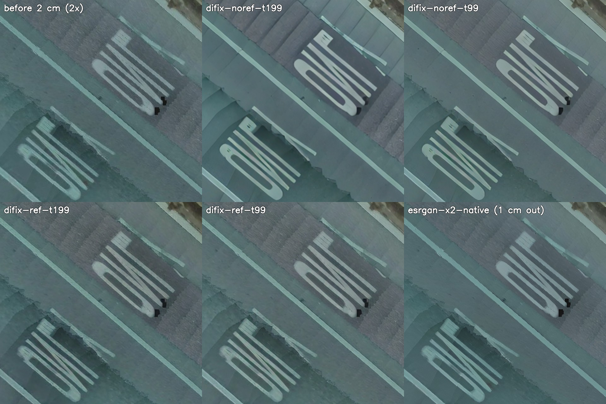

# Road texture refinement in bird's-eye space

**Verdict: no.** None of the tested settings clearly improves the road texture. Paint does not move (mean phase-correlation shift 0.07–0.19 px, max 0.66 px, i.e. ≤ 1.3 cm at 2 cm/px), but:

- **Difix noref** (t199, and less so t99) does sharpen paint strokes (the blurred second "ONLY" becomes crisp), but it also turns the mosaic's keyframe seams and scallops into hard-edged "pavement panels", rounds or re-draws stroke ends (yellow line end cap at the arrows), adds ~1.5 L* and a slight colour cast, and changes 15–24 % of road pixels by more than 10 levels. Thresholded paint area grows 30–43 % at t199 (precision@1 px 0.65–0.78): strokes get thicker and new bright detections appear. This is predicted content, not recovered detail.
- **Difix ref** (reference = the same mosaic, half a tile away) changes little (2–10 % of road pixels > 10 levels, paint recall/precision close to a JPEG q85 round trip) and the change is not visibly better.
- **Real-ESRGAN x2plus** acts like a mild denoise/blur: gradient energy drops to 0.81–0.85 (a σ = 0.8 px Gaussian gives 0.72–0.77), no new detail, paint precision ≈ 1.0 but recall falls like the blur control.

The dominant defects in the mosaics are stitching seams, scalloped keyframe boundaries and brightness bands, not missing high-frequency texture. No model removes them; Difix noref amplifies them. Fixing those belongs upstream (seam-aware/multiband blending in `pipeline/road/mosaic.py`), so nothing needs re-exporting from refined mosaics now.

## Models

| Model | Licence | Weights | Steps | MPS | s per tile (median) |
|---|---|---|---:|---|---|
| Difix noref (`nvidia/difix`, SD-Turbo) | NVIDIA, non-commercial | already in `$RS/third_party/hf` | 1 | yes, fp16 | 0.50–0.92 (768²) |
| Difix ref (`nvidia/difix_ref`) | NVIDIA, non-commercial | same | 1 | yes, fp16 | 1.12–1.45 (768²) |
| **Real-ESRGAN x2plus** (RRDBNet, 16.7 M) — chosen alternative | BSD-3-Clause | GitHub release, ungated, 64 MB | 1 (GAN) | yes, fp32 via `spandrel` | 0.19–0.34 (512² in, 1024² out) |
| InvSR (CVPR 2025, SD-Turbo + noise predictor) | NTU S-Lab, non-commercial | ungated | 1–5 | not tried | – |
| OSEDiff / PiSA-SR (SD 2.1 base + LoRA) | Apache-2.0 code; SD 2.1 base weights | one-step | 1 | not tried (needs SD 2.1 base + RAM tagger) | – |
| HYPIR (SIGGRAPH 2025, SD 2.1 LoRA) | non-commercial | ungated | 1 | not tried | – |
| TSD-SR (SD3 base) | – | SD3 base is gated | 1 | skipped (gated) | – |
| FLUX.2 [klein] 4B edit | Apache-2.0 | ungated | ~4 | not tried (≈13 GB, instruction edit redraws layout) | – |

Real-ESRGAN was picked as the alternative because it is the most layout-conservative class (no diffusion prior), permissive, tiny and runs on MPS without custom kernels; the one-step diffusion SR options are the same family as Difix (SD prior) and would add a second hallucinating model. The survey was limited (Parallel search was rate-limited; the fallback web search was used). Timings were taken with the Studio GPU shared with other jobs (load average ≈ 20), so they are upper bounds; first-tile times (model warm-up) were 0.3–7.9 s.

## Setup

Three 1536 × 1536 px (30.7 × 30.7 m) crops of `best.jpg` at 2 cm/px, offline (stitched) poses:

| Patch | Source | Content |
|---|---|---|
| arrows | `$RS/road/mosaics/offline/park` cols 1150–2686, rows 150–1686 | turn arrows, stop bar, yellow centre line, 93–97 s |
| bike | new window 106–118 s, `$RS/work/genfill/ground/mosaic/bike`, cols 2750–4286, rows 100–1636 | bike-lane symbol, arrows, 112–115 s |
| only | `$RS/road/mosaics/offline/turn` cols 1050–2586, rows 950–2486 | two "ONLY" words and arrows, 318–320 s |

Tiling: Difix 768 px tiles with 128 px overlap (9 tiles per patch), Real-ESRGAN 512 px tiles with 64 px overlap (16 tiles), linear feather blend. Difix ref used a tile of the same patch offset by 384 px (50 % overlap) as reference; there is no cleaner top-down photo to use. Real-ESRGAN modes: **native** = 2 cm in, 1 cm out, area-downsampled to 2 cm for the metrics; **half** = input downsampled to 4 cm then ×2 back to 2 cm.

Metrics, inside `road-mask.png`: paint = white top-hat (31 px ellipse) on CIELAB L* > 8, 2 × 2 opening, same threshold before and after. R@r = share of before-paint pixels with after-paint within r px; P@r the reverse. Shift = phase correlation of the top-hat image per 256 px block with ≥ 1 % paint (22, 16, 23 blocks). |Δ| = max-channel absolute RGB difference (0–255). Grad ratio = mean Sobel magnitude of L* after / before (> 1 = sharper). Two controls show the metric floor: a JPEG q85 round trip and a σ = 0.8 px Gaussian blur. The paint detector also fires on bright seams and speckle, which is why the blur control already loses 10–36 % recall.

## Results

### arrows (1.20 M road px, 97,956 paint px)

| setting | paint px after | R@1 | P@1 | R@3 | P@3 | shift mean / max px | road mean / p99 / max \|Δ\| | road > 10 / > 25 | signed ΔL* Δa Δb | grad ratio |
|---|---:|---:|---:|---:|---:|---:|---:|---:|---:|---:|
| difix-noref-t199 | 140,028 | 0.86 | 0.65 | 0.89 | 0.76 | 0.17 / 0.40 | 7.8 / 29 / 140 | 22.6 % / 1.6 % | 1.1 0.1 −0.8 | 1.05 |
| difix-noref-t99 | 100,088 | 0.78 | 0.78 | 0.84 | 0.87 | 0.18 / 0.41 | 7.0 / 24 / 152 | 15.0 % / 0.8 % | 1.6 0.5 0.2 | 0.87 |
| difix-ref-t199 | 104,150 | 0.92 | 0.88 | 0.96 | 0.94 | 0.09 / 0.22 | 4.4 / 17 / 118 | 5.1 % / 0.2 % | 0.4 −0.3 0.2 | 1.04 |
| difix-ref-t99 | 104,213 | 0.91 | 0.87 | 0.96 | 0.94 | 0.09 / 0.19 | 5.6 / 16 / 113 | 4.6 % / 0.2 % | 1.3 0.4 0.7 | 1.01 |
| esrgan-x2-native | 62,866 | 0.69 | 0.99 | 0.77 | 1.00 | 0.10 / 0.19 | 3.0 / 12 / 63 | 1.6 % / 0.0 % | 0.3 0.2 −0.3 | 0.81 |
| esrgan-x2-half | 67,194 | 0.69 | 0.97 | 0.76 | 0.99 | 0.27 / 0.43 | 3.7 / 20 / 104 | 4.4 % / 0.5 % | 0.2 0.2 −0.2 | 0.79 |
| control-jpeg85 | 105,624 | 0.96 | 0.91 | 0.98 | 0.96 | 0.04 / 0.11 | 2.3 / 10 / 39 | 0.7 % / 0.0 % | 0.0 0.0 0.0 | 1.02 |
| control-blur-s0.8 | 56,200 | 0.64 | 0.99 | 0.73 | 1.00 | 0.04 / 0.10 | 1.7 / 12 / 75 | 1.5 % / 0.1 % | 0.0 0.0 0.0 | 0.72 |

### bike (0.97 M road px, 51,710 paint px)

| setting | paint px after | R@1 | P@1 | R@3 | P@3 | shift mean / max px | road mean / p99 / max \|Δ\| | road > 10 / > 25 | signed ΔL* Δa Δb | grad ratio |
|---|---:|---:|---:|---:|---:|---:|---:|---:|---:|---:|
| difix-noref-t199 | 66,381 | 0.96 | 0.78 | 0.98 | 0.82 | 0.19 / 0.66 | 7.9 / 26 / 82 | 23.1 % / 1.0 % | 1.4 −0.2 −1.2 | 1.21 |
| difix-noref-t99 | 52,990 | 0.95 | 0.92 | 0.97 | 0.96 | 0.17 / 0.61 | 6.2 / 19 / 71 | 9.6 % / 0.4 % | 1.5 0.4 −0.1 | 0.96 |
| difix-ref-t199 | 54,886 | 0.97 | 0.94 | 0.98 | 0.96 | 0.10 / 0.18 | 4.5 / 15 / 94 | 2.9 % / 0.2 % | 0.7 −0.1 −0.2 | 1.03 |
| difix-ref-t99 | 56,300 | 0.98 | 0.92 | 0.99 | 0.95 | 0.07 / 0.12 | 5.5 / 12 / 63 | 2.2 % / 0.0 % | 1.5 0.6 0.3 | 1.05 |
| esrgan-x2-native | 45,748 | 0.91 | 0.99 | 0.93 | 1.00 | 0.13 / 0.26 | 2.5 / 9 / 45 | 0.7 % / 0.0 % | 0.3 0.3 −0.3 | 0.84 |
| esrgan-x2-half | 48,735 | 0.93 | 0.98 | 0.94 | 0.99 | 0.31 / 0.53 | 3.1 / 14 / 57 | 2.1 % / 0.1 % | 0.2 0.3 −0.2 | 0.81 |
| control-jpeg85 | 51,819 | 0.98 | 0.98 | 0.99 | 0.99 | 0.05 / 0.08 | 1.7 / 6 / 21 | 0.1 % / 0.0 % | 0.0 0.0 0.0 | 1.01 |
| control-blur-s0.8 | 45,643 | 0.89 | 1.00 | 0.91 | 1.00 | 0.05 / 0.09 | 1.2 / 9 / 41 | 0.8 % / 0.0 % | 0.0 0.0 0.0 | 0.77 |

### only (1.05 M road px, 162,132 paint px)

| setting | paint px after | R@1 | P@1 | R@3 | P@3 | shift mean / max px | road mean / p99 / max \|Δ\| | road > 10 / > 25 | signed ΔL* Δa Δb | grad ratio |
|---|---:|---:|---:|---:|---:|---:|---:|---:|---:|---:|
| difix-noref-t199 | 204,097 | 0.95 | 0.78 | 0.98 | 0.85 | 0.18 / 0.35 | 8.3 / 38 / 194 | 23.9 % / 3.1 % | 1.4 0.3 −0.4 | 1.08 |
| difix-noref-t99 | 159,576 | 0.92 | 0.94 | 0.94 | 0.98 | 0.19 / 0.40 | 7.8 / 31 / 171 | 18.2 % / 1.8 % | 1.6 0.7 0.4 | 0.96 |
| difix-ref-t199 | 170,317 | 0.96 | 0.93 | 0.98 | 0.96 | 0.11 / 0.20 | 5.5 / 24 / 167 | 9.9 % / 0.8 % | 0.2 −0.1 0.4 | 1.08 |
| difix-ref-t99 | 168,720 | 0.97 | 0.95 | 0.98 | 0.98 | 0.10 / 0.21 | 6.5 / 22 / 142 | 8.3 % / 0.6 % | 1.4 0.6 0.9 | 1.05 |
| esrgan-x2-native | 140,897 | 0.90 | 1.00 | 0.92 | 1.00 | 0.09 / 0.19 | 3.1 / 13 / 90 | 2.0 % / 0.1 % | 0.2 0.1 −0.3 | 0.85 |
| esrgan-x2-half | 148,233 | 0.90 | 0.98 | 0.93 | 0.99 | 0.25 / 0.62 | 4.3 / 23 / 138 | 6.2 % / 0.8 % | 0.0 0.2 −0.3 | 0.91 |
| control-jpeg85 | 166,722 | 0.97 | 0.96 | 0.99 | 0.99 | 0.04 / 0.09 | 2.5 / 11 / 30 | 1.3 % / 0.0 % | 0.0 0.0 0.0 | 1.02 |
| control-blur-s0.8 | 135,500 | 0.86 | 1.00 | 0.90 | 1.00 | 0.04 / 0.11 | 2.1 / 18 / 94 | 2.7 % / 0.5 % | 0.0 0.0 0.0 | 0.76 |

The esrgan-x2-half shifts (≈ −0.2, −0.2 px in every patch) are the resampling phase of the 2× down/up round trip, not the model.

### Where it changed ("predicted" content)

- Difix noref t199: everywhere on the road at a low level (mean 7.8–8.3 levels, colour/brightness lift), strongest along keyframe seams, at the edges of every paint stroke and on off-road vegetation and parked cars (max 140–194). 1.0–3.1 % of road pixels change by more than 25 levels. Treat the whole patch as predicted.
- Difix noref t99: same pattern, weaker (9.6–18.2 % > 10 levels).
- Difix ref t99/t199: mostly seams and stroke edges; 2.2–9.9 % > 10 levels, ≤ 0.8 % > 25. Inside the "ONLY" letters it adds fine horizontal striping (visible in the diff panel).
- Real-ESRGAN native: asphalt grain smoothed, stroke edges slightly cleaned; ≤ 2 % > 10 levels.

## Images

Each sheet: top row whole patch at 4 cm/px, bottom row a 15 m detail at 2 cm/px; before | after | |difference| × 4 (inferno). Zoom sheets show a 6.4 m crop around the main symbol at 2 × for every setting.

| Patch | Zoom (all settings) | Difix noref t199 | Difix ref t99 | Real-ESRGAN native |
|---|---|---|---|---|
| arrows | [zoom](report/arrows-zoom.jpg) | [sheet](report/arrows-difix-noref-t199.jpg) | [sheet](report/arrows-difix-ref-t99.jpg) | [sheet](report/arrows-esrgan-x2-native.jpg) |
| bike | [zoom](report/bike-zoom.jpg) | [sheet](report/bike-difix-noref-t199.jpg) | [sheet](report/bike-difix-ref-t99.jpg) | [sheet](report/bike-esrgan-x2-native.jpg) |
| only | [zoom](report/only-zoom.jpg) | [sheet](report/only-difix-noref-t199.jpg) | [sheet](report/only-difix-ref-t99.jpg) | [sheet](report/only-esrgan-x2-native.jpg) |

All settings are in `report/<patch>-<setting>.jpg`; numbers in [report/metrics.json](report/metrics.json).

## Perspective chase renders

[report/chase-render-difix-esrgan.jpg](report/chase-render-difix-esrgan.jpg): render | Difix ref t199 (existing result) | Real-ESRGAN x2 then area-downsampled to 1408 × 896, 8 views. Real-ESRGAN changes the renders by a mean 1.7–2.4 levels and fixes nothing (floaters, smeared trees and holes stay); Difix changes them by 10.9–16.5 levels and replaces whole regions with plausible but invented buildings, trees and road. Real-ESRGAN took 2.0–5.5 s per frame (16 tiles, GPU shared).

## If someone still wants refined mosaics in the ground splats

Not recommended from these results; for the record, the minimal path:

1. Input: a refined image on the **same grid** as the mosaic (same `grid.npz` origin/basis/cell 0.02 m and pixel size as `best.jpg`; Real-ESRGAN native also gives a 1 cm image whose grid is the same origin/basis with cell 0.01 m).
2. The v2 ground export (`pipeline/road/run_ground_v2.sh`) samples colour from native camera frames, not from mosaics, so there is no mosaic → splat colour step today. It would need a new pass that, for each exported disc, maps its ENU XY into the mosaic grid (`(xy − origin) @ basis / cell`), samples the refined RGB (bilinear) where `road-mask.png` is set, and rewrites the SH DC; geometry, opacity and time fields unchanged. Discs with a 4.1 cm tangent sigma cannot show 2 cm detail anyway.
3. Paint-safe variant worth testing instead: apply Difix noref t99 output only inside a dilated paint mask (stroke sharpening) and keep the original asphalt elsewhere.

## Follow-ups

1. Seam/scallop artefacts dominate the mosaics' look: try multiband or graph-cut seam blending in `pipeline/road/mosaic.py` before any learned refinement (road engineer).
2. Paint-masked Difix (point 3 above) on the same three patches with the same metrics.
3. A real top-down reference (native front frame rectified to the ground at 6–15 m) for Difix ref, instead of a neighbouring mosaic tile.
